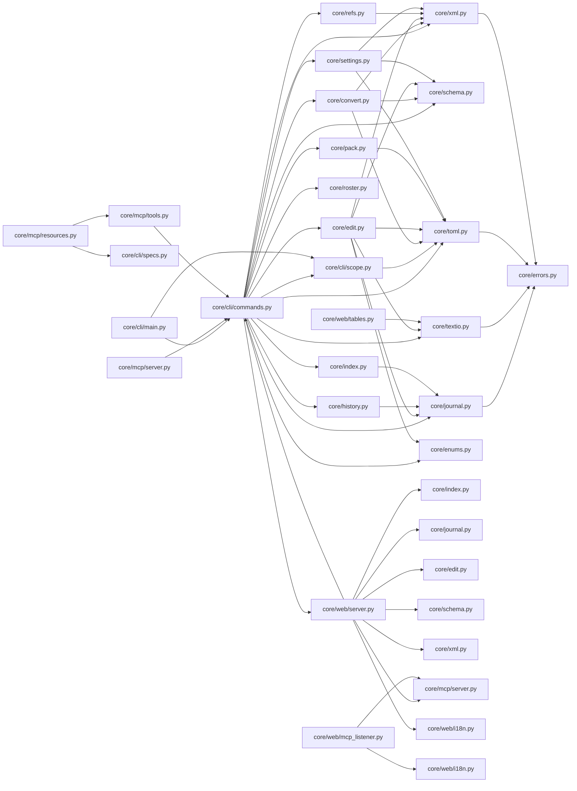
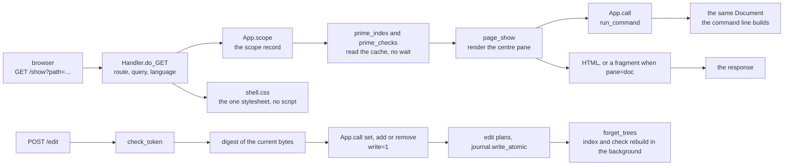
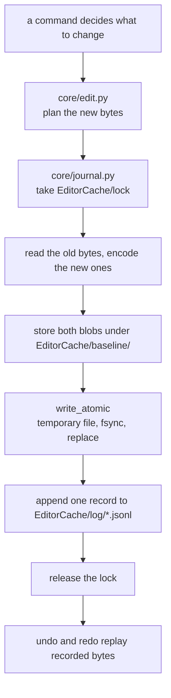

# How the editor works

This repository is the editor core: one command layer, three faces over it (a command line, an
MCP server and a web page), and the readers and writers for the game's own files. It is pure
Python over the standard library, it has no build step, and every face runs from source with
`python -m`. This page is the map: what starts, what calls what, which file holds which role,
what gets produced, and what is still missing.

## The whole picture

```mermaid
flowchart TD
    subgraph launcher["tools/launcher — how a person starts it"]
        L1["StartWebUI.cmd<br/>opens the page and keeps the console"]
        L2["StartWebUI(Basic).cmd<br/>the same without the console"]
        L3["Start(McpOnly).cmd<br/>MCP over stdio, no page"]
        L4["StopAll.cmd<br/>stops every instance"]
        L5["ff-tool.cmd<br/>the one entry the launchers call"]
        L6["_ff-tool-path.cmd<br/>finds python"]
        L7["ff-tool.ps1<br/>start, stop, list, the instance record"]
        L8["ff-start.cmd<br/>a console start for a project"]
    end

    subgraph faces["Four ways in"]
        F1["python -m core.cli<br/>core/cli/__main__.py"]
        F2["python -m core.mcp<br/>core/mcp/__main__.py"]
        F3["python -m core.cli Mod web<br/>core/web/server.py"]
        F4["DSH plugin<br/>separate repository, spawns ff-tool"]
    end

    subgraph cmd["The command layer"]
        C1["core/cli/main.py<br/>arguments, usage, exit codes"]
        C2["core/cli/commands.py<br/>run_command and 35 commands"]
        C3["core/cli/scope.py<br/>Mod / Firefight / name"]
        C4["core/cli/specs.py<br/>32 MCP tools"]
    end

    subgraph engine["The engine"]
        E1["core/xml.py<br/>layout XML reader"]
        E2["core/toml.py<br/>TOML reader and writer"]
        E3["core/convert.py<br/>XML to TOML and back"]
        E4["core/schema.py<br/>shapes and types"]
        E5["core/edit.py<br/>the write path"]
        E6["core/journal.py<br/>log, baselines, lock"]
        E7["core/history.py<br/>undo and redo"]
        E8["core/index.py<br/>index.toml and refs.toml"]
        E9["core/refs.py<br/>reference graph"]
        E10["core/settings.py<br/>mod.txt and ModSetting.toml"]
        E11["core/pack.py<br/>the mod zip"]
        E12["core/textio.py<br/>encoding and newlines"]
        E13["core/roster.py<br/>unit rosters by line"]
        E14["core/enums.py<br/>enum tables"]
        E15["core/errors.py<br/>the error model"]
    end

    subgraph web["The web face"]
        W1["core/web/server.py<br/>routes, pages, forms"]
        W2["core/web/tables.py<br/>the plain-text table editor"]
        W3["core/web/i18n.py<br/>templates and Chinese"]
        W4["core/web/mcp_listener.py<br/>MCP over HTTP"]
        W5["core/web/nat.py<br/>NAT-PMP and UPnP"]
    end

    subgraph mcp["The MCP face"]
        M1["core/mcp/server.py<br/>JSON-RPC loop"]
        M2["core/mcp/tools.py<br/>one command per tool"]
        M3["core/mcp/resources.py<br/>resources and prompts"]
    end

    subgraph stock["Game installation, read as one scope"]
        S1["Firefight/Data/**/*.txt<br/>the stock XML"]
        S2["Firefight/Images, Sounds<br/>images and sounds"]
        S3["Firefight.exe<br/>marks the installation"]
    end

    subgraph project["A project, Mod/&lt;name&gt;"]
        P1["ModInformation.toml<br/>name, version, prefix"]
        P2["ModSetting.toml<br/>the TOML form of mod.txt"]
        P3["mod.txt<br/>what the game reads"]
        P4["Data/**/*.toml<br/>working files"]
        P5["Images/, Sounds/<br/>copied assets"]
        P6["EditorCache/log/*.jsonl<br/>EditorCache/baseline/**<br/>EditorCache/lock"]
        P7["EditorCache/index.toml<br/>EditorCache/refs.toml"]
        P8["EditorCache/check.json<br/>the status-bar counts"]
    end

    subgraph temp["Outside both, so a game folder stays untouched"]
        T1["%TEMP%/firefight-mod-editor/check-&lt;digest&gt;.json<br/>the counts of an installation"]
    end

    subgraph made["What comes out"]
        Z1["&lt;name&gt;-&lt;version&gt;.zip<br/>Mod/ + README.md + LICENSE"]
        Z2["EditorCache/web.json<br/>the running instance"]
    end

    subgraph pending["Not yet done"]
        X1["core/schema.py<br/># TODO(m5): no schema for vehicle and at_gun"]
        X2["core/pack.py<br/># TODO(pack): stock-baseline comparison, APK"]
        X3["core/pack.py<br/># KNOWN: a TOML-only document is re-emitted canonically"]
        X4["no marker: init reads no template, assets only with convert assets=1,<br/>Maps/ Surnames/ equipment_* outside the schema, no retry<br/>against the stock corpus, no interactive batch editor, plugin tree elsewhere"]
    end

    L1 --> L5
    L2 --> L5
    L3 --> L5
    L4 --> L5
    L5 --> L6
    L5 --> L7
    L7 --> F3
    L7 --> F2
    L7 --> Z2
    L8 --> F3
    F4 --> L5
    F1 --> C1
    F2 --> M1
    F3 --> W1
    C1 --> C2
    C3 --> C2
    C2 --> C4
    C2 --> E10
    C2 --> E11
    C2 --> E13
    C2 --> E5
    C2 --> E6
    C2 --> E7
    C2 --> E8
    C2 --> E9
    E1 --> E3
    E2 --> E3
    E3 --> E4
    E5 --> E6
    E5 --> E1
    E5 --> E4
    E6 --> E7
    E9 --> E1
    E9 --> E8
    E10 --> E2
    E10 --> E1
    E11 --> E2
    E11 --> E1
    W1 --> C2
    W1 --> W2
    W1 --> W3
    W1 --> W4
    W1 --> E5
    W1 --> E8
    W2 --> E12
    W4 --> M1
    W4 --> W5
    M1 --> M2
    M1 --> M3
    M2 --> C2
    S1 -->|convert| P4
    S1 -->|firefight scope| C3
    S2 -->|"convert assets=1"| P5
    S3 -->|marks the scope| C3
    C2 -->|init, import| P1
    P2 -->|settings op=render| P3
    P3 -->|settings op=emit| P2
    P4 -->|set, add, remove| P4
    C2 -->|index --write| P7
    P7 -->|refs, deps| C2
    C2 --> P6
    P6 -->|undo, redo| P4
    C2 --> P8
    S3 --> T1
    C2 -->|pack| Z1
    P3 -->|pack| Z1
```

A scope is one directory the command layer reads: `Firefight` is the installation, `Mod` is a
project, and any other name is a directory given with `root=`. Every face opens a scope the same
way, through `core/cli/scope.py`, so a page, a tool and a command see the same files.

## Four ways in

| Entry | Started by | What it does |
| --- | --- | --- |
| `python -m core.cli` | `core/cli/__main__.py` | one command, one result; exit code 0, 1 or 2 |
| `python -m core.mcp` | `core/mcp/__main__.py` | stdio JSON-RPC, the 32 tools and three resource URIs |
| `python -m core.cli Mod web` | `core/web/server.py` through `serve()` | the pages, one `ThreadingHTTPServer`, an `EditorCache/web.json` record |
| DSH plugin | `ffplugin/` in its own repository | spawns `ff-tool.cmd`, so it lands on the same command layer |

`tools/launcher/ff-tool.ps1` is the only place that starts a process for a person: it writes the
instance record, hands the browser the address the server answers on, and stops what it started.
`StartWebUI.cmd` keeps its console open for 15 s to print that address.

Which module imports which, from the source:

## One page request

`core/web/server.py` keeps a tuple of route names. A GET is looked up there, the scope is opened,
`prime_index` and `prime_checks` read the caches without waiting, and `page_<route>` renders the
body; only then does the handler write the response. A write arrives as a POST to `/edit`, which
checks the token, reads the digest of the file it is about to change, and calls the same command
layer the command line uses.

The routes and what each one hands back:

| Route | Renders | Notes |
| --- | --- | --- |
| `index` | the scope table, the current scope's facts, the find form | `Setting.toml` warnings appear here |
| `list` | the entity list, unit rosters first, then the entity table with a pager | `page_size=`, `page=` |
| `show` | one document: raw text, TOML view, XML view, or one subtree | the centre pane |
| `get` | one field of one document | read only |
| `edit` | the field form for one document, and the POST target | needs `digest=` on a write |
| `find` | documents matching a name or a value | `q=`, `ignoreCase=` |
| `refs` | what one document points at | the reference rules |
| `deps` | what points at one document | the reverse graph |
| `check` | the check table with counts and samples | `assets=`, `rosters=`, `against=` |
| `stats` | per-category counts and sizes | |
| `equipment`, `tables` | the plain-text table editor | `equipment` is the older name of the same page |
| `twin` | the `.txt` companion of a `.toml` document | refuses a path that is not a twin |
| `log` | the journal segments, one page per write, with undo and redo | |
| `mcp` | the listener block, the connection lines, the tool table | |
| `mcpstart`, `mcpstop` | open or close the HTTP listener | opens a router mapping when the reach is `public` |
| `asset` | one image or sound, byte for byte | `raw=1` |
| `cmd` | the command line, with suggestions | `line=` carries the command |
| `json` | one command's JSON, unchanged | for scripts |
| `help` | the help text and the command index | |
| `quit` | stops the server | |
| `shell.css` | the one stylesheet every page links | cached for an hour |
| `favicon.ico` | nothing, status 204 | |

## One write

Every write, from any face, walks the same path:

A page write also drops the drawn tree (`App.forget_trees`), re-primes the reference cache and
asks for a new count, in the background, so the next page shows the new state without waiting.

## Repository files

Root files:

| Path | Role |
| --- | --- |
| `README.md`, `README.zh-CN.md` | what the editor is, how to start it, where the documents are |
| `CHANGELOG.md`, `CHANGELOG.zh-CN.md` | one entry per change, newest first |
| `LICENSE` | the licence |
| `.gitattributes` | `* text=auto eol=lf`, so a `.cmd` is stored with LF here |
| `.gitignore` | caches, `__pycache__`, a project's `EditorCache/` |

The command layer and the engine:

| Path | Role |
| --- | --- |
| `core/__init__.py` | `__version__`, the one place the version is written |
| `core/cli/__init__.py` | package marker |
| `core/cli/__main__.py` | the entry point behind `python -m core.cli` |
| `core/cli/main.py` | argument parsing, the usage text, exit codes |
| `core/cli/commands.py` | `run_command`, the 35 commands, `Document`, the write commands |
| `core/cli/scope.py` | `Mod`, `Firefight` and `<name>` resolution, `entity_files` |
| `core/registry.py` | the command table: name, handler, category, aliases, flags |
| `core/web/forms.py` | the writing forms, one declaration per writing command |
| `core/cli/specs.py` | the 31-entry tool table the MCP server renders |
| `core/xml.py` | the layout-preserving XML reader: raw tags, attributes, CDATA, comments |
| `core/toml.py` | the in-house TOML reader and writer |
| `core/convert.py` | XML to TOML and back, including the canonical writer |
| `core/schema.py` | shapes and types per root, plus the two project files |
| `core/refs.py` | reference rules and the graph over a corpus |
| `core/index.py` | writes and reads `EditorCache/index.toml` and `EditorCache/refs.toml` |
| `core/edit.py` | field writes, whole documents, array entries, locking, atomic replace |
| `core/journal.py` | log segments, baselines, the lock, `write_atomic` |
| `core/history.py` | plans and applies `undo` and `redo` |
| `core/settings.py` | renders `mod.txt` to `ModSetting.toml` and back |
| `core/pack.py` | `plan()` and `build()`: the members and the zip |
| `core/textio.py` | decoding, newlines, the export encoding |
| `core/roster.py` | the plain-text unit rosters, edited by physical line |
| `core/enums.py` | the enum tables |
| `core/errors.py` | `FfError`, `UsageError` and what a message carries |

The two server packages:

| Path | Role |
| --- | --- |
| `core/mcp/__init__.py` | the protocol constants both faces share |
| `core/mcp/__main__.py` | the entry point behind `python -m core.mcp` |
| `core/mcp/server.py` | the JSON-RPC loop, both protocol families, notifications |
| `core/mcp/tools.py` | one in-process command call per tool, writes only with `--write` |
| `core/mcp/resources.py` | the three resource URIs, their templates and the prompts |
| `core/web/__init__.py` | package marker |
| `core/web/server.py` | routes, pages, the write path, the style sheet, the instance record |
| `core/web/i18n.py` | the English templates and the Chinese table, key for key |
| `core/web/mcp_listener.py` | MCP over HTTP: token, bound address, the three reach options |
| `core/web/nat.py` | NAT-PMP and UPnP, the mapping and its withdrawal |
| `core/web/tables.py` | the plain-text table editor behind `/tables` and `/equipment` |

Documents, all in English and Chinese:

| Path | Role |
| --- | --- |
| `docs/flow.md`, `docs/flow.zh-CN.md` | this map |
| `docs/cli.md`, `docs/cli.zh-CN.md` | every command, its options and what it prints |
| `docs/web.md`, `docs/web.zh-CN.md` | the pages, the launcher, the caches, the listener |
| `docs/mcp.md`, `docs/mcp.zh-CN.md` | the tools, the resources, the protocol families |
| `docs/project-layout.md`, `docs/project-layout.zh-CN.md` | the project directory, the packaged output, the CLI contract |
| `docs/toml-mapping.md`, `docs/toml-mapping.zh-CN.md` | XML and TOML, the canonical form, the layout rules |
| `docs/refs.md`, `docs/refs.zh-CN.md` | the reference rules and how `refs`, `deps` and `check` use them |

Tests:

| Path | Role |
| --- | --- |
| `tests/__init__.py` | package marker, so `-t .` finds the tree |
| `tests/test_cli.py` | the command line end to end: every command, its options, its exit code |
| `tests/test_web.py` | every route, the write path, the listener, the caches, the shell |
| `tests/test_mcp.py` | the tools, the resources, the prompts, both protocol families |
| `tests/test_convert.py`, `tests/test_xml.py`, `tests/test_toml.py`, `tests/test_textio.py` | the readers and writers, including the stock dialect |
| `tests/test_roundtrip_bytes.py`, `tests/test_golden.py` | byte-for-byte round trips over recorded samples |
| `tests/test_documents.py`, `tests/test_entries.py`, `tests/test_set.py`, `tests/test_lists.py` | documents, array entries, field writes, list files |
| `tests/test_import.py`, `tests/test_init.py`, `tests/test_pack.py`, `tests/test_packager_tempfile.py` | project creation, import, packaging |
| `tests/test_index.py`, `tests/test_refs.py`, `tests/test_roster.py`, `tests/test_schema.py` | caches, reference graph, rosters, schema |
| `tests/test_undo.py`, `tests/test_combined.py`, `tests/test_convert_command.py` | the log and the undo path, several commands in one run, the `convert` command |
| `tests/test_settings.py`, `tests/test_errors.py` | `mod.txt` and the error model |
| `tests/test_nat.py` | NAT-PMP and UPnP against canned replies |
| `tests/fixtures/aircraft/`, `tests/fixtures/squad/`, `tests/fixtures/weapon/` | one recorded XML and TOML pair per root, used by the golden tests |
| `tests/fixtures/schema/path-inventory.tsv` | the recorded field inventory the schema is checked against |

Tools:

| Path | Role |
| --- | --- |
| `tools/launcher/ff-tool.ps1` | start, stop, list, the instance record |
| `tools/launcher/ff-tool.cmd`, `tools/launcher/_ff-tool-path.cmd`, `tools/launcher/ff-start.cmd` | the console entries |
| `tools/launcher/StartWebUI.cmd`, `StartWebUI(Basic).cmd`, `Start(McpOnly).cmd`, `StopAll.cmd` | the four things a person double-clicks |
| `tools/export_fidelity.py` | runs `export` over a data directory and compares every file byte for byte |
| `tools/m1_roundtrip.py` | XML to TOML to XML over the stock tree, one TSV report |
| `tools/extract_docs_md.py` | turns the game's own `.mht` documentation into one markdown file |
| `tools/FirefightModPackager/` | the upstream packager, vendored: `ff.py`, `ffpack.py`, `ffpack_gui.py`, `validate.py`, its data tables, a key, and `ManifestEditor/` with its upstream copy |

## Build artifacts and publishing

There is no build step and no compiled artifact. The core is pure Python over the standard
library, and every face runs from source with `python -m`. Two things are produced without a
build system:

| Artifact | Produced by | Contents |
| --- | --- | --- |
| The editor folder | copying `core/`, `docs/` and `tools/launcher/` next to `Setting.toml` | the same source, plus `Firefight/`, `Mod/` and `Setting.toml` pointing at this machine |
| `<name>-<version>.zip` | `pack` | `Mod/` with `mod.txt` rendered from `ModSetting.toml` and every `Data/**` document written as stock XML, then `README.md` and `LICENSE` at the root |

`pack` writes every member with a fixed timestamp, so the same project packs to the same bytes
and the tests can compare archives. `Setting.toml` is a local file: its keys name directories on
this machine and it is not part of the repository.

## Not yet done

| Missing | Marker |
| --- | --- |
| `vehicle` and `at_gun` documents have no schema, so `set` cannot name a field in one and `add` falls back to a bare root | `# TODO(m5)` in `core/schema.py` |
| the stock-baseline comparison and APK packaging of docs/project-layout.md section 5 | `# TODO(pack)` in `core/pack.py` |
| a document that exists only as TOML is re-emitted canonically, so a source file with other endings or indentation is not reproduced byte for byte | `# KNOWN:` in `core/pack.py` |

These have no marker yet:

* `init` writes `ModInformation.toml` and an empty `Data/` and nothing else; it reads no template
  and imports no stock data. `import` is the other direction: it turns a mod that already exists —
  a directory or a zip — into a project.
* `Images/` and `Sounds/` are imported only when `convert` is asked for them with `assets=1`;
  references to them stay dangling until the files are imported or placed by hand.
* `Maps/`, `Surnames/` and the `equipment_*` lists are outside the schema.
* a reference that does not resolve inside one scope is not retried against the stock corpus; the
  fallback is measured but not implemented.
* `batch` applies a patch file to many documents, but the patch is written by hand and the whole
  file is rewritten per document; there is no interactive multi-document editor.
* the DSH plugin lives in another repository (`ffplugin/`), so its tool list is checked against
  `core/cli/specs.py` only when that tree is reachable.
