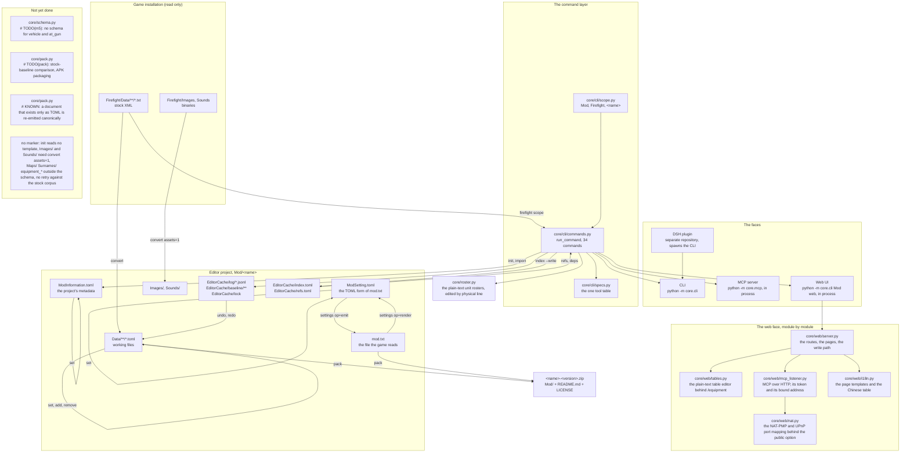

# How the editor works

This repository is the editor core: one command layer, three faces over it, and the readers
and writers for the game's files. There is no build step.

## The flow

Every write goes through `core/edit.py`, which stages the new bytes, holds `EditorCache/lock`,
stores the old and new blobs under `EditorCache/baseline/`, and appends one record to the log.
`undo` and `redo` write recorded bytes back, so the log is the only source of truth
(docs/project-layout.md section 8).

## Repository files

| Path | Role |
| --- | --- |
| `core/__init__.py` | the version number, written down in one place |
| `core/cli/__main__.py` | the entry point behind `python -m core.cli` |
| `core/cli/main.py` | argument parsing, the usage text, exit codes |
| `core/cli/commands.py` | every command and the `Document` it works on |
| `core/cli/scope.py` | `Mod`, `Firefight` and `<name>` resolution, `entity_files` |
| `core/cli/specs.py` | the tool table the MCP server renders and the plugin mirrors |
| `core/xml.py`, `core/toml.py` | the two parsers and the TOML writer |
| `core/convert.py` | XML to TOML and back, including the layout-preserving writer |
| `core/schema.py` | shapes and types per root, plus the two project files |
| `core/refs.py` | reference rules and the graph over a corpus |
| `core/index.py` | writes and reads `EditorCache/index.toml` and `EditorCache/refs.toml` |
| `core/edit.py` | field writes, whole documents, array entries, locking, atomic replace |
| `core/journal.py` | log segments, baselines, the lock |
| `core/history.py` | plans and applies `undo` and `redo` |
| `core/settings.py` | renders `mod.txt` to `ModSetting.toml` and back |
| `core/pack.py` | builds the mod-zip |
| `core/textio.py` | decoding, newlines, the export encoding |
| `core/enums.py`, `core/errors.py` | enum tables, the error model |
| `core/roster.py` | the plain-text unit rosters, edited by physical line |
| `core/mcp/` | stdio JSON-RPC server, its tools and resources |
| `core/mcp/__main__.py` | the entry point behind `python -m core.mcp` |
| `core/mcp/server.py` | the JSON-RPC loop, both protocol families |
| `core/mcp/tools.py` | one in-process command call per tool |
| `core/web/` | the pages, the instance record, the language table |
| `core/web/server.py` | the routes, the pages and the write path behind a form |
| `core/web/mcp_listener.py` | the optional MCP-over-HTTP socket, its token and its bound address |
| `core/web/nat.py` | the NAT-PMP and UPnP requests that open a port on the router |
| `core/web/tables.py` | the plain-text table editor the `/equipment` page runs |
| `core/web/i18n.py` | the English templates and the Chinese table |
| `docs/` | usage and architecture documents, each in English and Chinese |
| `docs/m1-design.md` | the M1 design note behind toml-mapping.md, not a usage document |
| `docs/firefight-docs/extract_docs_md.py` | turns the game's own .mht documentation into one markdown file |
| `tests/` | `python -m unittest discover -s tests -t .` |
| `tools/launcher/` | the PowerShell launcher and its `.cmd` entry points |
| `tools/export_fidelity.py` | runs `export` over a data directory and compares every file byte for byte |
| `tools/m1_roundtrip.py` | XML to TOML to XML over the stock tree, one TSV report |
| `tools/FirefightModPackager/` | the upstream packager, vendored |

## Build artifacts

There is no build step: the core is pure Python with no dependencies outside the standard
library, and the faces run from source with `python -m`.

Two artifacts exist, both produced outside a build system:

| Artifact | Produced by | Contents |
| --- | --- | --- |
| The editor folder | copying `core/`, `docs/` and `launcher/` next to the entry points | the same source plus `Firefight/`, `Mod/` and `Setting.toml` |
| `&lt;name&gt;-&lt;version&gt;.zip` | `pack` | `Mod/`, `README.md`, `LICENSE`; `Mod/mod.txt` is rendered from `ModSetting.toml`, `Mod/Data/**` documents are written back as stock XML, everything else is copied byte for byte |

`pack` writes members with a fixed timestamp, so the same project packs to the same bytes
and the tests can compare archives.

## Not yet done

| Missing | Marker |
| --- | --- |
| `vehicle` and `at_gun` documents have no schema, so `set` cannot name a field in one and `add` falls back to a bare root | `# TODO(m5)` in `core/schema.py` |
| the stock-baseline comparison and APK packaging of docs/project-layout.md section 5 | `# TODO(pack)` in `core/pack.py` |
| a document that exists only as TOML is re-emitted canonically, so a source file with other endings or indentation is not reproduced byte for byte | `# KNOWN:` in `core/pack.py` |

These have no marker yet:

* `init` writes `ModInformation.toml` and an empty `Data/` and nothing else; it reads no template and
  imports no stock data. `import` (§4.16 of cli.md) is the other direction: it turns a mod that
  already exists — a directory or a zip — into a project.
* `Images/` and `Sounds/` are imported only when `convert` is asked for them with `assets=1`;
  references to them stay dangling until the files are imported or placed by hand.
* `Maps/`, `Surnames/` and `equipment_*` lists are outside the schema.
* a reference that does not resolve inside one scope is not retried against the stock
  corpus; the fallback is measured (882 of 912 references in one real project) but not
  implemented.
* `batch` applies a patch file to many documents, but the patch is written by hand and the
  whole file is rewritten per document; there is no interactive multi-document editor.
