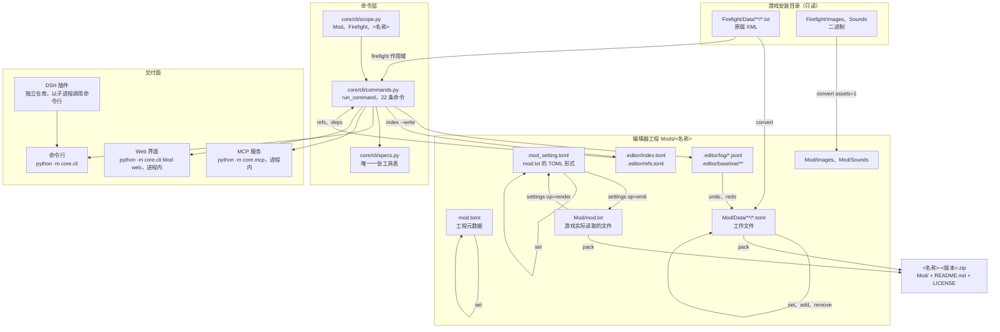

# 编辑器的工作方式

本仓库是编辑器核心：一层命令层，其上三个交付面，以及游戏文件的读写器。没有构建步骤。

## 数据流

每次写入都经过 `core/edit.py`：暂存新字节、持有 `.editor/lock`、把新旧字节存进
`.editor/baseline/`，再向日志追加一条记录。`undo` 与 `redo` 写回记录里的字节，因此日志是
唯一的事实来源（见 docs/project-layout.md 第 8 节）。

## 仓库文件

| 路径 | 作用 |
| --- | --- |
| `core/cli/main.py` | 参数解析、用法文本、退出码 |
| `core/cli/commands.py` | 全部命令，以及命令操作的 `Document` |
| `core/cli/scope.py` | `Mod`、`Firefight`、`<名称>` 三种作用域的解析，`entity_files` |
| `core/cli/specs.py` | MCP 服务据此渲染工具表、插件据此镜像的那张表 |
| `core/xml.py`、`core/toml.py` | 两个解析器与 TOML 写入器 |
| `core/convert.py` | XML 与 TOML 双向转换，含保布局写入器 |
| `core/schema.py` | 各根元素的形状与类型，以及两个工程文件 |
| `core/refs.py` | 引用规则与语料上的引用图 |
| `core/index.py` | 写出与读回 `.editor/index.toml` 与 `.editor/refs.toml` |
| `core/edit.py` | 字段写入、整文档增删、数组项、加锁、原子替换 |
| `core/journal.py` | 日志分段、基线、锁 |
| `core/history.py` | 规划并执行 `undo` 与 `redo` |
| `core/settings.py` | `Mod/mod.txt` 与 `mod_setting.toml` 的双向渲染 |
| `core/pack.py` | 生成模组 zip |
| `core/textio.py` | 解码、换行、导出编码 |
| `core/enums.py`、`core/errors.py` | 枚举表与错误模型 |
| `core/mcp/` | stdio JSON-RPC 服务、其工具与资源 |
| `core/web/` | 页面、运行实例记录、语言表 |
| `docs/` | 说明文档与架构文档，中英各一份 |
| `tests/` | `python -m unittest discover -s tests -t .` |
| `tools/launcher/` | PowerShell 启动器与其 `.cmd` 入口 |
| `tools/FirefightModPackager/` | vendored 的上游打包器 |

## 构建产物

没有构建步骤：核心是纯 Python，除标准库外无依赖，各交付面都以 `python -m` 从源码运行。

存在两种产物，都由构建系统之外的方式产生：

| 产物 | 产生方式 | 内容 |
| --- | --- | --- |
| 编辑器文件夹 | 把 `core/`、`docs/`、`tools/launcher/` 复制到启动器入口旁 | 同一份源码，另加 `Firefight/`、`Mods/` 与 `.ff-editor.local.toml` |
| `&lt;名称&gt;-&lt;版本&gt;.zip` | `pack` | `Mod/`、`README.md`、`LICENSE`；`Mod/mod.txt` 由 `mod_setting.toml` 渲染，`Mod/Data/**` 的文档回写为原版 XML，其余逐字节复制 |

`pack` 以固定时间戳写入成员，因此同一工程两次打包得到相同字节，用例可以直接比较压缩包。

## 待完成

| 缺失 | 标记 |
| --- | --- |
| `vehicle` 与 `at_gun` 文档没有 schema，`set` 无法指定其字段，`add` 只能写裸根 | `core/schema.py` 的 `# TODO(m5)` |
| docs/project-layout.md 第 5 节的 stock 基线比对与 APK 打包 | `core/pack.py` 的 `# TODO(pack)` |
| 只有 TOML 的文档按规范形式回写，换行或缩进不同的源文件无法逐字节复现 | `core/pack.py` 的 `# KNOWN:` |

以下尚无标记：

* `init` 只写出 `mod.toml` 与空的 `Mod/Data`，不读模板、不导入原版数据。
* `Images/` 与 `Sounds/` 只在 `convert` 带 `assets=1` 时导入；指向它们的引用在导入或手工放置文件前一直是悬空引用。
* `Maps/`、`Surnames/` 与 `equipment_*` 清单不在 schema 范围内。
* 在某一个作用域内解析不到的引用不会再向原版语料回退；该回退已测量（某个真实工程
  912 条中 882 条可解析）但未实现。
* 没有批量编辑。
