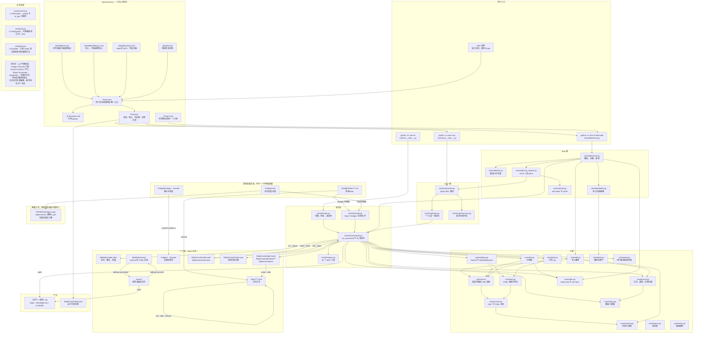
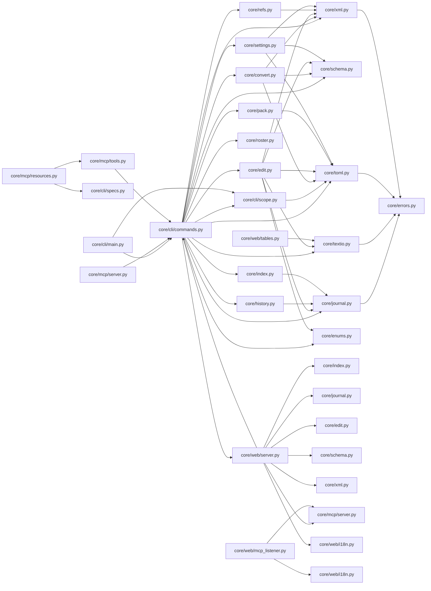
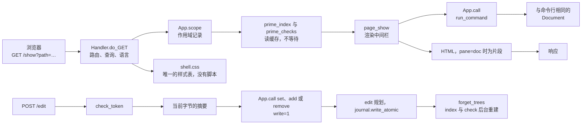
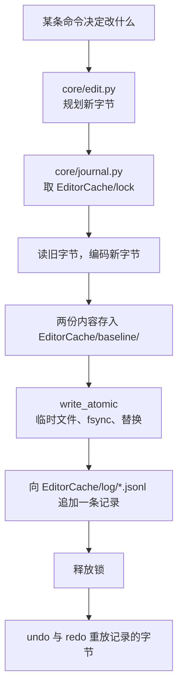

# 编辑器的工作方式

本仓库是编辑器核心：一层命令层，命令层之上三个入口（命令行、MCP 服务、网页），以及游戏自身文件的读写实现。全部是标准库上的纯 Python，没有构建步骤，任何入口都可用 `python -m` 从源码直接运行。本页是地图：什么被启动、谁调用谁、哪个文件承担哪个职责、产出什么、还缺什么。

## 全图

作用域是命令层读取的一个目录：`Firefight` 是安装目录，`Mod` 是一个工程，其他名字是用 `root=` 给出的目录。三个入口都用 `core/cli/scope.py` 打开作用域，所以页面、工具与命令看到的是同一批文件。

## 四个入口

| 入口 | 由什么启动 | 做什么 |
| --- | --- | --- |
| `python -m core.cli` | `core/cli/__main__.py` | 一条命令一个结果；退出码 0、1、2 |
| `python -m core.mcp` | `core/mcp/__main__.py` | stdio 上的 JSON-RPC，32 个工具与三个资源 URI |
| `python -m core.cli Mod web` | `core/web/server.py` 的 `serve()` | 页面、一个 `ThreadingHTTPServer`、一份 `EditorCache/web.json` 记录 |
| DSH 插件 | 独立仓库的 `ffplugin/` | 调用 `ff-tool.cmd`，因此落到同一层命令 |

`tools/launcher/ff-tool.ps1` 是唯一替人启动进程的地方：它写实例记录、把服务实际应答的地址交给浏览器、并停止自己启动的东西。`StartWebUI.cmd` 保留控制台 15 秒，用于打印该地址。

模块导入关系（由源码抽取）：

## 一次页面请求

`core/web/server.py` 保存一个路由元组。GET 先在其中查名，打开作用域，由 `prime_index` 与 `prime_checks` 读取缓存且不等待，再由 `page_<路由>` 渲染正文，最后由处理函数写出响应。写入以 POST 到 `/edit` 到达，它校验令牌、读取即将修改那文件的摘要，然后调用与命令行相同的命令层。

路由与各自的产出：

| 路由 | 渲染内容 | 说明 |
| --- | --- | --- |
| `index` | 作用域表、当前作用域事实、查找表单 | `Setting.toml` 的提示出现在这里 |
| `list` | 实体列表（单位表在前）与带分页的实体表 | `page_size=`、`page=` |
| `show` | 一篇文档：原文、TOML 视图、XML 视图或某棵子树 | 中间栏 |
| `get` | 一篇文档的一个字段 | 只读 |
| `edit` | 一篇文档的字段表单，同时是 POST 目标 | 写入需 `digest=` |
| `find` | 按文件名或按取值匹配的文档 | `q=`、`ignoreCase=` |
| `refs` | 一篇文档指向什么 | 引用规则 |
| `deps` | 什么指向这篇文档 | 反向图 |
| `check` | 检查表、计数与样本 | `assets=`、`rosters=`、`against=` |
| `stats` | 按类别的数量与大小 | |
| `equipment`、`tables` | 纯文本表编辑 | `equipment` 是同页的旧名 |
| `twin` | 某 `.toml` 文档的 `.txt` 副本 | 非副本路径被拒绝 |
| `log` | 日志分段，每次写入一页，含撤销与重做 | |
| `mcp` | 监听块、连接两行、工具表 | |
| `mcpstart`、`mcpstop` | 打开或关闭 HTTP 监听 | 开放范围为 `public` 时申请路由器映射 |
| `asset` | 一张图或一个音效，原样字节 | `raw=1` |
| `cmd` | 命令行，带提示补全 | `line=` 携带命令 |
| `json` | 一条命令的 JSON，原样 | 供脚本使用 |
| `help` | 帮助正文与命令索引 | |
| `quit` | 停止服务 | |
| `shell.css` | 每个页面都链接的那份样式表 | 缓存一小时 |
| `favicon.ico` | 空，状态 204 | |

## 一次写入

任何入口的写入都走同一条路：

页面写入还会丢弃已画出的树（`App.forget_trees`），重新预读引用缓存并在后台请求新计数，因此下一页不必等待就能显示新状态。

## 仓库文件

根文件：

| 路径 | 作用 |
| --- | --- |
| `README.md`、`README.zh-CN.md` | 编辑器是什么、怎么启动、文档在哪 |
| `CHANGELOG.md`、`CHANGELOG.zh-CN.md` | 一项改动一条，新版本在前 |
| `LICENSE` | 许可证 |
| `.gitattributes` | `* text=auto eol=lf`，因此 `.cmd` 在此仓库按 LF 存放 |
| `.gitignore` | 缓存、`__pycache__`、工程内的 `EditorCache/` |

命令层与引擎：

| 路径 | 作用 |
| --- | --- |
| `core/__init__.py` | `__version__`，版本号唯一写入处 |
| `core/cli/__init__.py` | 包标记 |
| `core/cli/__main__.py` | `python -m core.cli` 的入口 |
| `core/cli/main.py` | 参数解析、用法文本、退出码 |
| `core/cli/commands.py` | `run_command`、35 条命令、`Document`、写入命令 |
| `core/cli/scope.py` | `Mod`、`Firefight` 与任意名字的解析、`entity_files` |
| `core/registry.py` | 命令表：名字、处理函数、类别、别名与各项标记 |
| `core/web/forms.py` | 写入表单，每条写入命令一份声明 |
| `core/cli/specs.py` | MCP 服务渲染的 32 条工具表 |
| `core/xml.py` | 保留排版的 XML 读取：原始标签、属性、CDATA、注释 |
| `core/toml.py` | 自带的 TOML 读取与写出 |
| `core/convert.py` | XML 与 TOML 互转，含规范形写出 |
| `core/schema.py` | 按根标签的形状与类型，以及两个工程文件 |
| `core/refs.py` | 引用规则与语料上的引用图 |
| `core/index.py` | 写读 `EditorCache/index.toml` 与 `EditorCache/refs.toml` |
| `core/edit.py` | 字段写入、整篇文档、数组条目、加锁、原子替换 |
| `core/journal.py` | 日志分段、基线、锁、`write_atomic` |
| `core/history.py` | 规划并执行 `undo` 与 `redo` |
| `core/settings.py` | `mod.txt` 与 `ModSetting.toml` 互转 |
| `core/pack.py` | `plan()` 与 `build()`：成员清单与 zip |
| `core/textio.py` | 解码、换行、导出编码 |
| `core/roster.py` | 纯文本单位表，按物理行编辑 |
| `core/enums.py` | 枚举表 |
| `core/errors.py` | `FfError`、`UsageError` 与消息携带的内容 |

两个服务包：

| 路径 | 作用 |
| --- | --- |
| `core/mcp/__init__.py` | 两个入口共用的协议常量 |
| `core/mcp/__main__.py` | `python -m core.mcp` 的入口 |
| `core/mcp/server.py` | JSON-RPC 循环、两代协议、通知 |
| `core/mcp/tools.py` | 一个工具一次进程内命令调用，只有 `--write` 才写 |
| `core/mcp/resources.py` | 三个资源 URI、其模板与提示词 |
| `core/web/__init__.py` | 包标记 |
| `core/web/server.py` | 路由、页面、写入路径、外壳、实例记录 |
| `core/web/i18n.py` | 英文模板与中文表，逐键对应 |
| `core/web/mcp_listener.py` | HTTP 上的 MCP：令牌、绑定地址、三种开放范围 |
| `core/web/nat.py` | NAT-PMP 与 UPnP，映射与撤回 |
| `core/web/tables.py` | `/tables` 与 `/equipment` 背后的纯文本表编辑 |

文档，均中英各一份：

| 路径 | 作用 |
| --- | --- |
| `docs/flow.md`、`docs/flow.zh-CN.md` | 本页地图 |
| `docs/cli.md`、`docs/cli.zh-CN.md` | 每条命令、选项与输出 |
| `docs/web.md`、`docs/web.zh-CN.md` | 页面、启动器、缓存、监听 |
| `docs/mcp.md`、`docs/mcp.zh-CN.md` | 工具、资源、两代协议 |
| `docs/project-layout.md`、`docs/project-layout.zh-CN.md` | 工程目录、交付形态、命令行契约 |
| `docs/toml-mapping.md`、`docs/toml-mapping.zh-CN.md` | XML 与 TOML、规范形、排版规则 |
| `docs/refs.md`、`docs/refs.zh-CN.md` | 引用规则，以及 `refs`、`deps`、`check` 如何使用 |

测试：

| 路径 | 作用 |
| --- | --- |
| `tests/__init__.py` | 包标记，使 `-t .` 找到整棵树 |
| `tests/test_cli.py` | 命令行的端到端：每条命令、选项、退出码 |
| `tests/test_web.py` | 每条路由、写入路径、监听、缓存、外壳 |
| `tests/test_mcp.py` | 工具、资源、提示词、两代协议 |
| `tests/test_convert.py`、`tests/test_xml.py`、`tests/test_toml.py`、`tests/test_textio.py` | 读取与写出，含原版方言 |
| `tests/test_roundtrip_bytes.py`、`tests/test_golden.py` | 已录样本上的逐字节往返 |
| `tests/test_documents.py`、`tests/test_entries.py`、`tests/test_set.py`、`tests/test_lists.py` | 文档、数组条目、字段写入、清单类文件 |
| `tests/test_import.py`、`tests/test_init.py`、`tests/test_pack.py`、`tests/test_packager_tempfile.py` | 建工程、导入、打包 |
| `tests/test_index.py`、`tests/test_refs.py`、`tests/test_roster.py`、`tests/test_schema.py` | 缓存、引用图、单位表、模式 |
| `tests/test_undo.py`、`tests/test_combined.py`、`tests/test_convert_command.py` | 日志与撤销路径、一次运行多条命令、`convert` 命令 |
| `tests/test_settings.py`、`tests/test_errors.py` | `mod.txt` 与错误模型 |
| `tests/test_nat.py` | 用预置应答测 NAT-PMP 与 UPnP |
| `tests/fixtures/aircraft/`、`tests/fixtures/squad/`、`tests/fixtures/weapon/` | 每个根标签一对已录 XML 与 TOML，供黄金用例使用 |
| `tests/fixtures/schema/path-inventory.tsv` | 已录的字段清单，模式据此核对 |

工具：

| 路径 | 作用 |
| --- | --- |
| `tools/launcher/ff-tool.ps1` | 启动、停止、列实例、实例记录 |
| `tools/launcher/ff-tool.cmd`、`tools/launcher/_ff-tool-path.cmd`、`tools/launcher/ff-start.cmd` | 控制台入口 |
| `tools/launcher/StartWebUI.cmd`、`StartWebUI(Basic).cmd`、`Start(McpOnly).cmd`、`StopAll.cmd` | 人直接双击的四项 |
| `tools/export_fidelity.py` | 对一个数据目录跑 `export` 并逐字节比较每个文件 |
| `tools/m1_roundtrip.py` | 在原版树上做 XML→TOML→XML，输出一份 TSV 报告 |
| `tools/extract_docs_md.py` | 把游戏自带的 `.mht` 文档抽成一份 markdown |
| `tools/FirefightModPackager/` | 上游打包器，随仓库携带：`ff.py`、`ffpack.py`、`ffpack_gui.py`、`validate.py`、其数据表、一份密钥，以及附带上游副本的 `ManifestEditor/` |

## 构建产物与发布

没有构建步骤，也没有编译产物。核心是标准库上的纯 Python，任何入口都用 `python -m` 从源码运行。不经构建系统而存在两样产出：

| 产物 | 由什么产生 | 内容 |
| --- | --- | --- |
| 编辑器文件夹 | 把 `core/`、`docs/`、`tools/launcher/` 与 `Setting.toml` 放在一起复制 | 同一份源码，另加 `Firefight/`、`Mod/` 与指向本机的 `Setting.toml` |
| `<名字>-<版本>.zip` | `pack` | `Mod/`（其中 `mod.txt` 由 `ModSetting.toml` 生成，`Data/**` 每篇文档按原版 XML 写出），根下再放 `README.md` 与 `LICENSE` |

`pack` 以固定时间戳写每个成员，因此同一工程打出相同字节，用例才能比较压缩包。`Setting.toml` 是本机文件：其键指向本机目录，不属于仓库。

## 尚未完成

| 缺项 | 标记 |
| --- | --- |
| `vehicle` 与 `at_gun` 文档没有模式，`set` 无法指出其中字段，`add` 退化为裸根标签 | `core/schema.py` 的 `# TODO(m5)` |
| project-layout.md 第 5 节所述与原版基线比对、APK 打包 | `core/pack.py` 的 `# TODO(pack)` |
| 仅有 TOML 的文档按规范形重新写出，因此换行或缩进不同的源文件不能逐字节复现 | `core/pack.py` 的 `# KNOWN:` |

以下尚无标记：

* `init` 只写 `ModInformation.toml` 与空的 `Data/`，不读模板、不导入原版数据；反方向是 `import`：把一个已存在的 mod（目录或 zip）变成工程。
* `Images/` 与 `Sounds/` 仅在 `convert` 带 `assets=1` 时导入；在导入或手工放置之前，指向它们的引用是悬空的。
* `Maps/`、`Surnames/` 与 `equipment_*` 清单在模式之外。
* 一个作用域内解析不到的引用不会对原版语料重试；该回退已测量但未实现。
* `batch` 能用补丁文件批量改文档，但补丁需手写，且每篇文档整篇重写；没有交互式的多文档编辑界面。
* DSH 插件在另一个仓库（`ffplugin/`），只有该树可达时才会把它的工具表与 `core/cli/specs.py` 核对。
